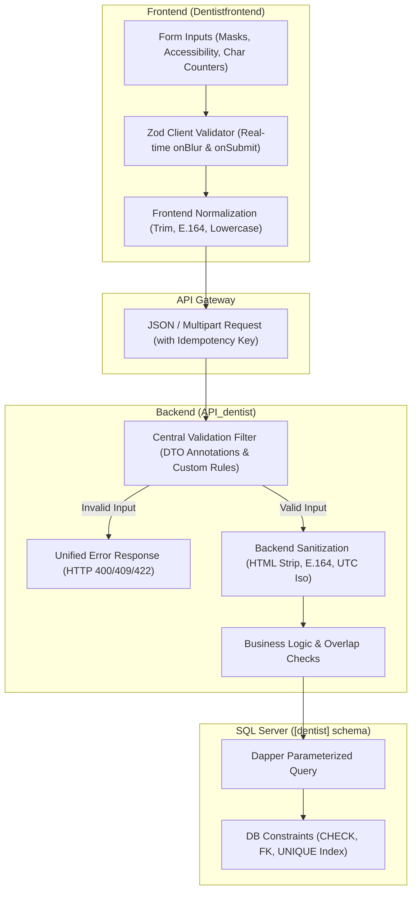

# 🛡️ DENTIA PRACTICE MANAGEMENT PLATFORM
## Complete Data Accuracy & Validation Audit (Step 0)

> **Document Status:** Complete Audit Specification & Architectural Plan  
> **Date:** October 14, 2026  
> **Target Workspaces:** `F:\DentistApp_Theme2\Dentistfrontend` and `F:\DentistApp_Theme2\DentistAPIClone\API_dentist`

---

## 1. Stack Identification & Architecture

| Component | Detected Technology | Validation Status & Recommended Strategy |
| :--- | :--- | :--- |
| **Frontend Framework** | **React 19** (`19.2.8`) + **Vite 8** (`8.2.0`), React Router v7 | **No schema validation library installed.** Ad-hoc `if/else` checks on few inputs. **Strategy:** Introduce **Zod** (`zod`) as the single source of truth for client-side schemas, real-time inline validation, input masks, and sanitized submissions. |
| **Styling & UI** | **Tailwind CSS v4** (`4.3.3`) + Lucide Icons | Accessible form controls (`aria-invalid`, `aria-describedby`), loading spinners, disabled states during submission. |
| **Backend Framework** | **ASP.NET Core Web API** (`.NET 10.0` / Web SDK) | C# `Controllers` with manual `if (string.IsNullOrEmpty(...))` checks. **Strategy:** Introduce structured C# Validators / DTO Data Annotations that mirror Zod schemas 1-to-1, with a Central Validation ActionFilter and Global Error Handler returning consistent envelope: `{ success: false, error: { code: "VALIDATION_ERROR", message: "...", fields: { ... } } }`. |
| **ORM & Data Access** | **Dapper 2.1.79** + ADO.NET `Microsoft.Data.SqlClient` | Parameterized SQL queries already in use. Need strict DB schema constraints (NOT NULL, CHECK, UNIQUE indexes, FKs). |
| **Database Engine** | **Microsoft SQL Server** (`[dentist]` schema) | Needs data cleanup script, duplicate detection, and migration script for missing constraints. |
| **File / Media Security** | Custom `FileUploadSecurityService.cs` | Magic byte inspection exists for multipart uploads in `RadiographsController`, but missing in base64 X-ray ingestion (`XRayUploadController`), profile image uploads, and patient portal attachments. |

---

## 2. Comprehensive Audit Table: Pages, Forms & API Endpoints

The table below catalogs every user-facing page, form, interactive input, and corresponding backend API route across Dentia, contrasting current validation against identified gaps.

| Page / Component / Route | Form / Inputs | Current Validation | Gaps & Failure Modes | Proposed Schema & Validation Rule |
| :--- | :--- | :--- | :--- | :--- |
| **New Patient Intake**<br>`/new-patient`<br>`POST /api/patients` | `firstName`, `lastName`, `dob`, `phone`, `email`, `gender`, `address`, `cnic` / `nhiNumber`, `dentitionType`, `selectedAllergies`, `medicalNotes`, `medications`, `emergencyContact`, `profileImage` | - Frontend checks `firstName`, `lastName` >= 2 letters.<br>- Checks `dob` is not future.<br>- Backend checks: `DoctorID > 0`, non-empty names, duplicate check on name+DOB/phone.<br>- Max image size 5MB. | - `phone` treated as optional in frontend; no Pakistani format (+92 / 03XXXXXXXXX) enforcement.<br>- No E.164 phone normalization before DB write.<br>- `email` not trimmed or lowercased.<br>- `cnic` has no 13-digit mask (`XXXXX-XXXXXXX-X`).<br>- `selectedAllergies` can be left blank (not explicitly confirmed as "None").<br>- No max length enforcement on address (could exceed 250 chars).<br>- Free-text injection risk in medicalNotes. | **PatientIntakeSchema (Zod & C#)**:<br>- `firstName`, `lastName`: 2-100 chars, `^[a-zA-Z\s.'-]+$`<br>- `phone`: `^(\+92\|0)?3[0-9]{9}$` -> normalized to `+923XXXXXXXXX`<br>- `email`: optional, RFC 5322 regex, lowercase, max 254<br>- `cnic`: optional, `^[0-9]{5}-[0-9]{7}-[0-9]{1}$`<br>- `dob`: required date, age between 0 and 120 yrs<br>- `gender`: enum `['male', 'female', 'other']`<br>- `allergies`: required array or explicit "None"<br>- `address`: max 250 chars, trimmed. |
| **Clinician Auth**<br>`/login`<br>`POST /api/auth/login`<br>`POST /api/auth/register` | `username`, `password`, `firstName`, `lastName`, `region`, `specialization`, `title`, `confirmPassword` | - Basic string presence check.<br>- BCrypt hash verification.<br>- Username duplicate check. | - No password complexity enforcement (min 8 chars, uppercase, lowercase, digit, special symbol).<br>- Login returns detailed message revealing invalid credentials vs invalid username.<br>- Username allows leading/trailing whitespace.<br>- No max password length (potential bcrypt 72-byte truncation attack). | **DoctorAuthSchema**:<br>- `username`: 3-50 chars, alphanumeric + dots/underscores, lowercase, trimmed.<br>- `password`: 8-72 chars, regex `(?=.*[a-z])(?=.*[A-Z])(?=.*\d)(?=.*[^a-zA-Z\d])`.<br>- Generic error: `"Invalid credentials. Please verify your username and password."`<br>- Strict rate-limiting (`auth-strict`). |
| **Patient Portal Auth**<br>`/portal/login`<br>`/portal/register`<br>`/portal/activate`<br>`POST /api/patient-auth/*` | `identifier` (phone/email/ref), `password`, `confirmPassword`, `referenceNumber`, `dob` | - Basic presence check.<br>- Plaintext fallback exists in dev mode (Security Risk). | - Patient registration does not validate phone format.<br>- Password not checked for complexity.<br>- Fallback plaintext password match allows unhashed passwords.<br>- Missing rate-limit on activation attempts. | **PatientPortalAuthSchema**:<br>- Identifiers trimmed & normalized.<br>- Ban plaintext password comparison.<br>- Reference number format `^PAT-[0-9]{6,}$` or `^[0-9]+$`.<br>- Passwords enforce min 8 chars with complexity. |
| **Book Appointment**<br>`/book`<br>`POST /api/appointments` | `patientID`, `doctorID`, `fullName`, `phone`, `email`, `preferredDate`, `reason`, `durationMinutes`, `notes`, `selectedProcedures` | - Checks `doctorID`, `fullName`, `phone` (min 10 digits), `preferredDate` not in past.<br>- Backend checks exact match of `PreferredDate` for any patient. | - Does not verify if `patientID` or `doctorID` actually exist in DB.<br>- Double-booking check checks all doctors clinic-wide instead of the specific `doctorID`.<br>- No check for clinic operating hours (e.g. 08:00 - 20:00).<br>- `duration` not bounded (could be negative or > 8 hours).<br>- Procedure fee can be submitted as arbitrary number. | **AppointmentBookingSchema**:<br>- `patientID`: required valid positive int.<br>- `doctorID`: required active doctor.<br>- `preferredDate`: valid future date/time within 08:00-20:00.<br>- `durationMinutes`: int, 15 to 240 mins.<br>- Overlap check: `StartTime < ExistingEnd AND EndTime > ExistingStart` for the same `doctorID`.<br>- `phone`: Pakistani E.164. |
| **Appointment Management**<br>`/appointments`<br>`PUT /api/appointments/{id}` | `status`, `preferredDate`, `doctorID`, `notes`, `reason`, `invoiceStatus` | - Basic route parameter binding. | - Invalid status transitions allowed (e.g., `completed` back to `pending`).<br>- Status accepts arbitrary strings.<br>- Rescheduling does not re-run doctor collision check. | **AppointmentUpdateSchema**:<br>- `status`: enum `['pending', 'confirmed', 'in_progress', 'completed', 'cancelled', 'no_show']`.<br>- State machine validation (e.g. `completed` is a terminal state unless admin override).<br>- Collision re-check upon date/time alteration. |
| **Odontogram & Charting**<br>`/chart/:patientId`<br>`/chart/:patientId/tooth/:toothNumber`<br>`POST /api/patients/teeth/update-bulk`<br>`POST /api/patients/{id}/treatment-plan` | `toothNumber`, `toothKey`, `dentitionCategory`, `conditionStatus`, `conditionColor`, `surface` (M,O,D,B,L,I), `comments`, `fee`, `treatmentStage` | - Basic integer conversion.<br>- Palette sets condition status strings. | - `toothNumber` accepts arbitrary integers (out-of-bounds FDI numbers allowed).<br>- `surface` accepts free text.<br>- `fee` is float in some DTOs (precision loss risk).<br>- No validation that treatment date is after patient registration date.<br>- Color hex values unvalidated. | **OdontogramTreatmentSchema**:<br>- `toothNumber`: FDI standard validation (Adult: 11-18, 21-28, 31-38, 41-48; Pediatric: 51-55, 61-65, 71-75, 81-85).<br>- `surface`: enum subset `['M','O','D','B','L','I','V','Cervical','Root','Full']`.<br>- `fee`: decimal >= 0, max 2 decimal places.<br>- Condition & Treatment: Whitelisted clinical terminology enum only. |
| **NanoPix RVG & X-Ray**<br>`NanoPixCaptureModal.jsx`<br>`DentiaAIRadiologyStudioPage.jsx`<br>`POST /api/xray/upload`<br>`POST /api/radiographs/patients/{id}/radiographs` | `patientId`, `toothKey`, `file`, `previewBase64`, `sensorSN`, `resolution`, `encryptedPayload`, `iv`, `tag` | - Extension check (`.png`, `.jpg`, `.dcm`).<br>- Multipart uploads checked via `FileUploadSecurityService` for magic bytes.<br>- Base64 upload checks `patientId > 0`. | - Base64 endpoint in `XRayUploadController` does not verify magic bytes before writing to disk.<br>- Corrupted, 0-byte or blank base64 strings accepted.<br>- Missing max payload size check on base64 before decoding (memory bomb risk).<br>- Tooth key not validated against FDI notation. | **XRayCaptureUploadSchema**:<br>- MIME: `image/png`, `image/jpeg`, `application/dicom`.<br>- Magic Byte validation: PNG (`89 50 4E 47`), JPEG (`FF D8 FF`), DICOM (`44 49 43 4D` at offset 128).<br>- Max size: 15 MB.<br>- Sanitized alphanumeric storage name with random GUID.<br>- Mandatory verification that `patientId` exists and is linked. |
| **Treatment Pricing**<br>`/treatment-pricing`<br>`PUT /api/treatment-pricing/doctor/{id}` | `procedureCode`, `procedureName`, `category`, `standardFee`, `doctorPrice` | - Basic decimal parsing. | - Negative prices accepted.<br>- More than 2 decimal places allowed.<br>- Arbitrary category names allowed. | **TreatmentPricingSchema**:<br>- `procedureCode`: uppercase alphanumeric, max 20 chars.<br>- `category`: enum from master clinical specialties.<br>- `doctorPrice`: decimal >= 0.00, <= 100000.00, 2 decimals. |
| **Billing & Invoices**<br>`/portal/billing`<br>`POST /api/billing/create-invoice`<br>`POST /api/billing/pay-online` | `invoiceId`, `patientId`, `amount`, `paymentMethod`, `cardNumber`, `cardExp`, `cvv`, `voucherCode` | - Amount > 0 check.<br>- Basic payment simulation. | - Card number not validated via Luhn algorithm.<br>- CVV accepts any string length.<br>- Expiry date accepts past dates.<br>- Double payment possible if user double-clicks submit. | **BillingPaymentSchema**:<br>- Idempotency Key header on payment submit.<br>- Card: Luhn check, 16 digits.<br>- Expiry: MM/YY, future date.<br>- CVV: 3-4 digits.<br>- Amount: matches outstanding invoice balance exactly. |
| **Admin Doctor & Organization**<br>`/admin/doctors`<br>`/admin/organizations`<br>`POST /api/auth/doctors`<br>`POST /api/organizations` | Doctor details (names, email, fee, specialization), Org details (name, slug, email, phone, website, accreditation) | - Presence of basic strings. | - Doctor fee accepts negative values.<br>- Org slug can contain spaces/special characters.<br>- Org phone and email unvalidated.<br>- Website accepts non-HTTP/HTTPS URLs. | **AdminDoctorAndOrgSchema**:<br>- `slug`: lowercase, hyphens, alphanumeric `^[a-z0-9-]+$`.<br>- `website`: valid URL starting with `https://`.<br>- `consultationFee`: decimal >= 0.<br>- Phone and email strictly validated. |

---

## 3. Entity-by-Entity Validation Rules Specification

### 3.1 Patient Entity
```typescript
PatientSchema = {
  firstName: z.string().trim().min(2).max(50).regex(/^[a-zA-Z\s.'-]+$/),
  lastName: z.string().trim().min(2).max(50).regex(/^[a-zA-Z\s.'-]+$/),
  phone: z.string().trim().regex(/^(\+92|0)?3[0-9]{9}$/), // Normalized to +923XXXXXXXXX
  email: z.string().trim().email().max(254).toLowerCase().optional().or(z.literal('')),
  cnic: z.string().trim().regex(/^[0-9]{5}-[0-9]{7}-[0-9]{1}$/).optional().or(z.literal('')),
  dob: z.string().refine(val => {
    const d = new Date(val);
    const now = new Date();
    const age = (now - d) / (365.25 * 24 * 3600 * 1000);
    return !isNaN(d.getTime()) && d <= now && age >= 0 && age <= 120;
  }, "Valid date of birth required (age 0-120, not in future)"),
  gender: z.enum(['male', 'female', 'other']),
  address: z.string().trim().max(250).optional(),
  dentitionType: z.enum(['Adult', 'Pediatric', 'Mixed']).default('Adult'),
  allergies: z.string().trim().min(1, "Allergies must be explicitly recorded (enter 'None' if no allergies)"),
  medicalHistory: z.string().trim().max(2000).optional(),
  medications: z.string().trim().max(1000).optional()
}
```

### 3.2 Appointment Entity
```typescript
AppointmentSchema = {
  patientID: z.number().int().positive(),
  doctorID: z.number().int().positive(),
  preferredDate: z.string().datetime().refine(val => {
    const d = new Date(val);
    const hour = d.getHours();
    return d > new Date() && hour >= 8 && hour < 20;
  }, "Appointment must be in future during clinic hours (08:00 - 20:00)"),
  durationMinutes: z.number().int().min(15).max(240).default(30),
  status: z.enum(['pending', 'scheduled', 'confirmed', 'completed', 'cancelled', 'no_show']),
  reason: z.string().trim().min(3).max(200),
  notes: z.string().trim().max(1000).optional()
}
```

### 3.3 Odontogram & Treatment Entity
```typescript
TeethStateSchema = {
  toothNumber: z.number().int().refine(t => {
    const validAdult = (t >= 11 && t <= 18) || (t >= 21 && t <= 28) || (t >= 31 && t <= 38) || (t >= 41 && t <= 48);
    const validPeds = (t >= 51 && t <= 55) || (t >= 61 && t <= 65) || (t >= 71 && t <= 75) || (t >= 81 && t <= 85);
    return validAdult || validPeds;
  }, "Tooth number must follow standard FDI notation (11-48, 51-85)"),
  surface: z.enum(['M', 'O', 'D', 'B', 'L', 'I', 'V', 'Cervical', 'Root', 'Full']).optional(),
  conditionStatus: z.enum([
    'Healthy', 'Caries', 'Restored', 'Crown', 'Root Canal', 'Missing',
    'Implant', 'Fractured', 'Bridge Abutment', 'Impacted', 'Decayed'
  ]),
  fee: z.number().min(0).max(500000).refine(f => Number(f.toFixed(2)) === f, "Fee must have max 2 decimal places")
}
```

### 3.4 RVG / X-Ray / Upload Entity
```typescript
XRayUploadSchema = {
  patientId: z.number().int().positive(),
  toothKey: z.string().regex(/^[0-9A-Za-z_-]{1,10}$/).optional(),
  fileSignature: z.enum(['image/png', 'image/jpeg', 'application/dicom']),
  maxSizeBytes: 15 * 1024 * 1024,
  sensorSN: z.string().trim().max(50).optional()
}
```

---

## 4. Normalization & Sanitization Pipeline

Before persisting any incoming payload, the following normalization rules apply:
1. **String Sanitization:**
   - Strip HTML tags (`<script>`, `<iframe>`, `<div>`, etc.) to prevent XSS.
   - Trim leading and trailing whitespace; collapse multiple internal consecutive spaces into a single space.
2. **Phone Number Normalization (Pakistan):**
   - Input: `0300 1234567` or `0300-1234567` or `923001234567` or `+92-300-1234567`
   - Normalized Output: `+923001234567` (Standard E.164).
3. **Email Normalization:**
   - Convert to lowercase, trim whitespace.
4. **CNIC Normalization:**
   - Format: `XXXXX-XXXXXXX-X` (13 numeric digits with hyphens).
5. **Date Normalization:**
   - Convert all dates to UTC ISO 8601 (`YYYY-MM-DDTHH:mm:ss.sssZ`).
6. **Financial Numbers:**
   - Quantized to 2 decimal places (`decimal(18,2)`), never stored as floating-point.

---

## 5. Database Cleanup & Constraint Audit

### 5.1 Pre-Migration Audit Script (`AUDIT_CLEANUP_CHECK.sql`)
Before applying new SQL constraints (`NOT NULL`, `CHECK`, `UNIQUE`), we must query for existing data inconsistencies:
1. **Invalid Phone Numbers:** Patients where `Phone` does not match valid format or has less than 10 digits.
2. **Duplicate Patients:** Multiple patients with identical Name + DOB or Name + Phone.
3. **Invalid Tooth Numbers:** Records in `dentist.TeethState` where `ToothNumber` is not a valid FDI number.
4. **Orphaned Records:** Appointments, TeethState, or Radiographs referencing non-existent `PatientID` or `DoctorID`.
5. **Negative Fees:** Records in `Appointments`, `DoctorTreatmentPricing`, or `Invoices` where fee < 0.

### 5.2 Proposed Database Constraints
- `ALTER TABLE [dentist].[Patients] ADD CONSTRAINT CK_Patients_Gender CHECK (Gender IN ('male', 'female', 'other'));`
- `ALTER TABLE [dentist].[Patients] ADD CONSTRAINT CK_Patients_Dentition CHECK (DentitionType IN ('Adult', 'Pediatric', 'Mixed'));`
- `ALTER TABLE [dentist].[Appointments] ADD CONSTRAINT CK_Appointments_Status CHECK (Status IN ('Pending', 'Scheduled', 'Confirmed', 'In Progress', 'Completed', 'Cancelled', 'No Show'));`
- `ALTER TABLE [dentist].[TeethState] ADD CONSTRAINT CK_TeethState_ToothNumber CHECK ((ToothNumber BETWEEN 11 AND 18) OR (ToothNumber BETWEEN 21 AND 28) OR (ToothNumber BETWEEN 31 AND 38) OR (ToothNumber BETWEEN 41 AND 48) OR (ToothNumber BETWEEN 51 AND 55) OR (ToothNumber BETWEEN 61 AND 65) OR (ToothNumber BETWEEN 71 AND 75) OR (ToothNumber BETWEEN 81 AND 85));`
- `CREATE UNIQUE INDEX UQ_Doctor_Appointment_Time ON [dentist].[Appointments](DoctorID, PreferredDate) WHERE Status NOT IN ('Cancelled', 'No Show');`

---

## 6. Implementation Architecture



---

## 7. Deliverables Checklist for Approval

1. [x] **Audit First (Step 0):** This detailed audit report and mapping table.
2. [ ] **Shared Validation Specifications:** Create `Dentistfrontend/src/validators/` containing modular Zod schemas for Patients, Appointments, Odontogram, Auth, Imaging, and Billing.
3. [ ] **Backend Validation Middleware & DTOs:** Add ASP.NET Core ActionFilters and DTO validator attributes returning standardized `{ success: false, error: ... }`.
4. [ ] **Frontend Form Hardening:** Update `NewPatientPage.jsx`, `BookAppointment.jsx`, `AppointmentsList.jsx`, `Auth.jsx`, `ChartPage.jsx`, `DoctorManagement.jsx`, and Patient Portal forms with:
   - Real-time inline field validation and error banners.
   - Input masks (Pakistani phone, CNIC).
   - Character counters, submit button disabling (double-submit prevention).
   - Accessibility (`aria-invalid`, `aria-describedby`, error field auto-focus).
5. [ ] **Database Integrity Script:** Generate diagnostic SQL script to inspect existing anomalies before applying constraints.
6. [ ] **Automated Tests:** Unit tests for Zod validation schemas and C# endpoint validation filters.
