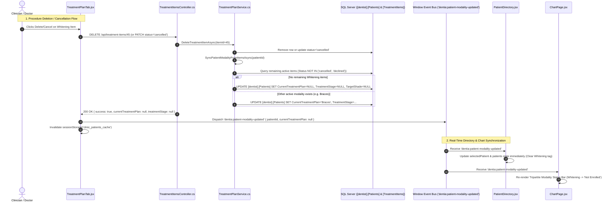

# Technical Specification: Clinical Modality Lifecycle Synchronization & Chart Status Display

**Document Version:** 1.0.0  
**Status:** Approved for Implementation  
**Target Subsystems:**
- `DentistAPI/Services/TreatmentPlanService.cs` & `Controllers/TreatmentItemsController.cs`
- `src/components/TreatmentPlanTab.jsx`
- `src/pages/PatientDirectory.jsx`
- `src/pages/ChartPage.jsx`

---

## 1. Executive Summary & Root Cause Analysis

### 1.1 The User Problem
1. **Directory Modality Ghosting (Stale State):**  
   A clinician selects **Whitening** (or **Braces**, or **Cavity**) in the Patient Directory (`/directory`). The backend records this in `[dentist].[Patients]` (`CurrentTreatmentPlan`, `TreatmentStage`, `TargetShade`) and backfills an item into `[dentist].[TreatmentItems]` via `/sync-directory`. Later, the clinician opens the **Treatment Plan** tab and removes/deletes the Whitening procedure. However, returning to the Directory page still shows **Whitening** as the active modality for that patient. The directory does not reset.
2. **Chart Page Status Absence:**  
   On the **Chart Page** (`/chart/:patientId`), the real-time status of these three clinical sections (**Braces**, **Whitening**, and **Cavities**) is either completely missing, hidden behind a single conditional banner that only shows one modality if pre-existing, or fails to reflect live changes. Clinicians cannot see the tri-modality status (current stage, wire, session, shade, affected cavity teeth) at a glance.

---

### 1.2 Root Cause Analysis (Deep Dive)

| Layer | Component | Failure Mechanism |
| :--- | :--- | :--- |
| **Backend DB** | `[dentist].[Patients]` vs `[dentist].[TreatmentItems]` | `CurrentTreatmentPlan` and `TreatmentStage` live on the `Patients` record. When an item in `TreatmentItems` is cancelled (`status = 'cancelled'`) or deleted, **no cascading update** was triggered to evaluate remaining active procedures. `Patients.CurrentTreatmentPlan` remained `'Teeth Whitening'` indefinitely. |
| **Backend API** | `TreatmentItemsController.cs` | No standard `DELETE /api/treatment-items/{id}` endpoint existed. Deletions could only be performed via status patch to `'cancelled'`, leaving the item in the database without syncing `Patients`. Furthermore, `/api/patients/{id}/sync-directory` would run on chart load and recreate the deleted item from the stale `Patients.CurrentTreatmentPlan`. |
| **Frontend Cache** | `PatientDirectory.jsx` | Directory caches the patient list in `sessionStorage.getItem('clinic_patients_cache')`. When procedures changed in `TreatmentPlanTab.jsx`, no cross-tab/cross-view event was dispatched to invalidate this cache or update the local patient model. |
| **Frontend UI** | `ChartPage.jsx` | Modality status was rendered via a single conditional block (`patient.currentTreatmentPlan && (...)`) that only rendered **one** modality using an `if / else if` cascade. If no modality was set, or if the patient had both Braces and Cavities, only one (or none) appeared. There was no tripartite status bar showing Braces, Whitening, and Cavities side-by-side. |

---

## 2. Architectural Solution & System Flow



---

## 3. Detailed Technical Specifications

### 3.1 Backend Service: Modality Auto-Recalculation Contract
In `TreatmentPlanService.cs`, implement `SyncPatientModalityFromItemsAsync(int patientId, IDbConnection conn, IDbTransaction? tx = null)`:

1. **Active Items Inspection:**
   ```sql
   SELECT TreatmentItemID, ProcedureName, Category, Status, ToothNo, SourceRef, PriceNote
   FROM [dentist].[TreatmentItems]
   WHERE PatientID = @PatientId
     AND Status NOT IN ('cancelled', 'declined')
   ORDER BY TreatmentItemID DESC
   ```
2. **Modality Evaluation Matrix:**
   - **Orthodontics / Braces:** Matches if `Category = 'ortho'` OR `ProcedureName LIKE '%brace%'` OR `ProcedureName LIKE '%ortho%'`.
   - **Whitening:** Matches if `Category = 'whitening'` OR `ProcedureName LIKE '%whiten%'` OR `ProcedureName LIKE '%bleach%'`.
   - **Cavity / Restorative:** Matches if `Category = 'restorative'` OR `ProcedureName LIKE '%cavity%'` OR `ProcedureName LIKE '%restor%'` OR `ProcedureName LIKE '%resin%'` OR `ProcedureName LIKE '%composite%'`.
3. **Synchronization Logic:**
   - If the patient's existing `CurrentTreatmentPlan` was **Whitening**, and **no active Whitening items** remain:
     - Clear `CurrentTreatmentPlan = NULL`, `TreatmentStage = NULL`, `TargetShade = NULL` (or fallback to any active Braces/Cavity item).
   - If the patient's existing `CurrentTreatmentPlan` was **Braces**, and **no active Braces items** remain:
     - Clear `CurrentTreatmentPlan = NULL`, `TreatmentStage = NULL`, `TargetShade = NULL` (or fallback).
   - If the patient's existing `CurrentTreatmentPlan` was **Cavity**, and **no active Cavity items** remain:
     - Clear `CurrentTreatmentPlan = NULL`, `TreatmentStage = NULL`, `TargetShade = NULL` (or fallback).
   - If **all** items are cleared, set `CurrentTreatmentPlan = NULL`, `TreatmentStage = NULL`, `TargetShade = NULL`.
4. **Trigger Points:**
   - `DeleteTreatmentItemAsync`: after deleting item and its allocations.
   - `UpdateTreatmentItemStatusAsync`: when `newStatus` is `'cancelled'`, `'declined'`, or `'completed'`.
   - `CreateTreatmentItemAsync`: when adding a new modality procedure.

---

### 3.2 Backend Controller: Safe Deletion Endpoints
In `TreatmentItemsController.cs`:
- `DELETE /api/treatment-items/{id:long}`
- `DELETE /api/patients/{patientId:int}/treatment-items/{id:long}`

**Behavior:**
1. Check if item exists.
2. Check if item has paid allocations. If paid > 0 and not admin/override, require voiding payment first or confirm cancellation.
3. Remove payment allocations associated with the item (or return to credit pool).
4. Remove row from `[dentist].[TreatmentItems]`.
5. Call `SyncPatientModalityFromItemsAsync(item.PatientId)`.
6. Return `200 OK` with:
   ```json
   {
     "success": true,
     "deletedItemId": 45,
     "patientId": 12,
     "currentTreatmentPlan": null,
     "treatmentStage": null,
     "message": "Treatment item deleted and patient modality reset."
   }
   ```

---

### 3.3 Frontend Event Bus & Directory Real-Time Reset
In `src/components/TreatmentPlanTab.jsx` and `src/pages/PatientDirectory.jsx`:
1. When deleting/cancelling an item:
   ```javascript
   sessionStorage.removeItem('clinic_patients_cache');
   window.dispatchEvent(new CustomEvent('dentia:patient-modality-updated', {
     detail: {
       patientId,
       currentTreatmentPlan: resData.currentTreatmentPlan,
       treatmentStage: resData.treatmentStage,
       targetShade: resData.targetShade,
       deletedItemId: itemId
     }
   }));
   ```
2. In `PatientDirectory.jsx`:
   - Listen for `'dentia:patient-modality-updated'`.
   - Match `e.detail.patientId` against `selectedPatient.patientID`:
     - Update `selectedPatient.currentTreatmentPlan` and `treatmentStage`.
     - Update `activeTreatmentTag` (set to `null` if modality cleared).
     - Update `patients` list and sync to `clinic_patients_cache`.
   - The Whitening / Braces / Cavity buttons and the "Active:" badge in the patient details panel immediately disappear or update.

---

### 3.4 Frontend Chart Page: Tripartite Clinical Modalities Status Suite
On `ChartPage.jsx`, replace the single conditional banner with an always-present, high-visibility **Tripartite Clinical Modalities Status Bar** featuring 3 dedicated cards:

```
+------------------------------------------------------------------------------------------------------------------------+
| 🩺 CLINICAL MODALITIES CURRENT STATUS                                                                                  |
+------------------------------------+------------------------------------+----------------------------------------------+
| 🦷 1. BRACES (ORTHODONTICS)        | ✨ 2. TEETH WHITENING              | ⚡ 3. CAVITIES & RESTORATIVE                 |
| Status: ACTIVE                     | Status: IN PROGRESS                | Status: 2 PLANNED (ATTENTION)                |
| Stage: Stage 1 (Leveling & Align)  | Session: Session 2 of 3            | Teeth: #14 (O - Composite), #19 (MO - GIC)   |
| Wire: 0.014 Heat-Activated NiTi    | Shade: A3.5 ➔ B1 (Laser Activated) | Caries Diagnosed: 2 Detected on Odontogram   |
| [View in Plan] [Open Ortho Suite]  | [View in Plan] [Update Session]    | [View in Plan] [Odontogram Focus]            |
+------------------------------------+------------------------------------+----------------------------------------------+
```

#### Card Specifications:
1. **🦷 Braces (Orthodontics):**
   - **Active State:** When `patient.currentTreatmentPlan` includes braces or an active ortho treatment item exists.
     - Displays: Current Stage (e.g. `Stage 1 (Leveling)`), Archwire (e.g. `0.014 NiTi`), Badge: `Active (Sky-600)`.
   - **Inactive State:** Badge: `Not Started (Slate-400)`. Subtext: "No active orthodontic protocol". Quick button: `+ Enroll Braces`.
2. **✨ Teeth Whitening:**
   - **Active State:** When `patient.currentTreatmentPlan` includes whitening or an active whitening treatment item exists.
     - Displays: Session progress (e.g. `Session 1 of 3`), Shade progression (e.g. `Initial: A3.5 ➔ Target: B1`), Badge: `In Progress (Amber-600)`.
   - **Inactive State:** Badge: `Not Started (Slate-400)`. Subtext: "No cosmetic whitening prescribed". Quick button: `+ Start Whitening`.
3. **⚡ Cavities & Restorative:**
   - **Active/Planned State:** Derived from both treatment items (`category = 'restorative'`) and odontogram findings (`cariesCount > 0` or unplanned findings).
     - Displays: Planned count (e.g. `2 Teeth Requiring Restorations`), itemized teeth list (e.g. `#14 O, #19 MO`), Badge: `Needs Restoration (Rose-600)`.
   - **Healthy State:** Badge: `All Clean (Emerald-600)`. Subtext: "0 Active Caries Detected". Quick button: `Review Teeth`.

---

## 4. Verification & Testing Strategy

1. **Unit Tests (`tests/unit/modality_deletion_sync_and_chart_status.test.mjs`):**
   - Test 1: Deleting a Whitening treatment item resets `Patients.CurrentTreatmentPlan` when no whitening items remain.
   - Test 2: Deleting a Braces item resets `Patients.CurrentTreatmentPlan`.
   - Test 3: Deleting a Cavity item resets `Patients.CurrentTreatmentPlan`.
   - Test 4: When multiple modalities exist (e.g. Whitening + Braces), deleting Whitening leaves Braces active.
   - Test 5: Tripartite modality status calculation produces accurate states for all three sections simultaneously.
2. **End-to-End Browser Flow:**
   - Step 1: Open Directory, assign Whitening to a patient. Verify Whitening badge is displayed.
   - Step 2: Open Chart Page. Verify Whitening card shows "In Progress" with shade and session.
   - Step 3: Open Treatment Plan tab, delete/cancel Whitening procedure.
   - Step 4: Verify Chart Page Whitening card resets to "Not Started".
   - Step 5: Navigate back to Directory. Verify patient record no longer displays Whitening.
   - Step 6: Repeat with Braces and Cavity.

---

## 5. Execution Roadmap

| Phase | Milestone | File(s) |
| :--- | :--- | :--- |
| **Phase 1** | Implement `SyncPatientModalityFromItemsAsync` & Delete endpoints | `DentistAPI/Services/TreatmentPlanService.cs`<br>`DentistAPI/Controllers/TreatmentItemsController.cs` |
| **Phase 2** | Add deletion action & event dispatch | `src/components/TreatmentPlanTab.jsx` |
| **Phase 3** | Subscribe to event bus & invalidate cached state | `src/pages/PatientDirectory.jsx` |
| **Phase 4** | Build Tripartite Clinical Modalities Status Suite | `src/pages/ChartPage.jsx` |
| **Phase 5** | Automated testing & validation | `tests/unit/modality_deletion_sync_and_chart_status.test.mjs` |
| **Phase 6** | Build, sync repositories, and commit | `Dentistfrontend`, `DentistAPIClone\API_dentist`, `DentistApp_Theme2` |
